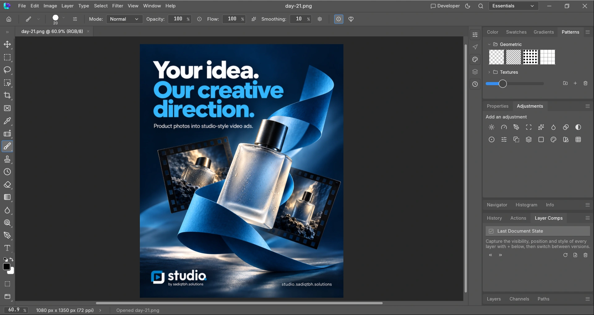
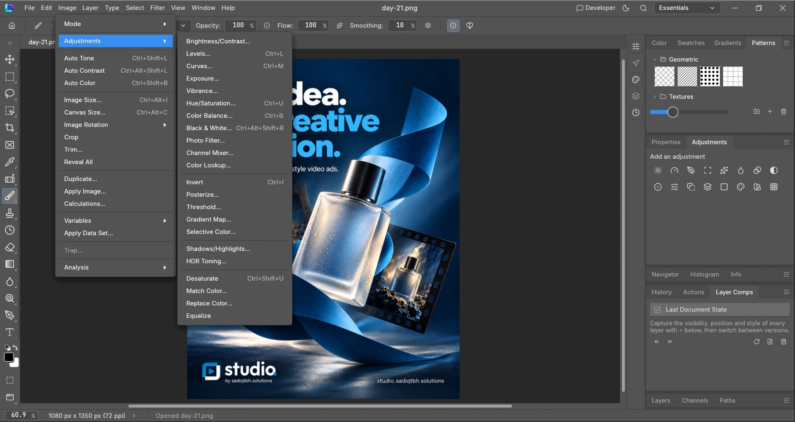
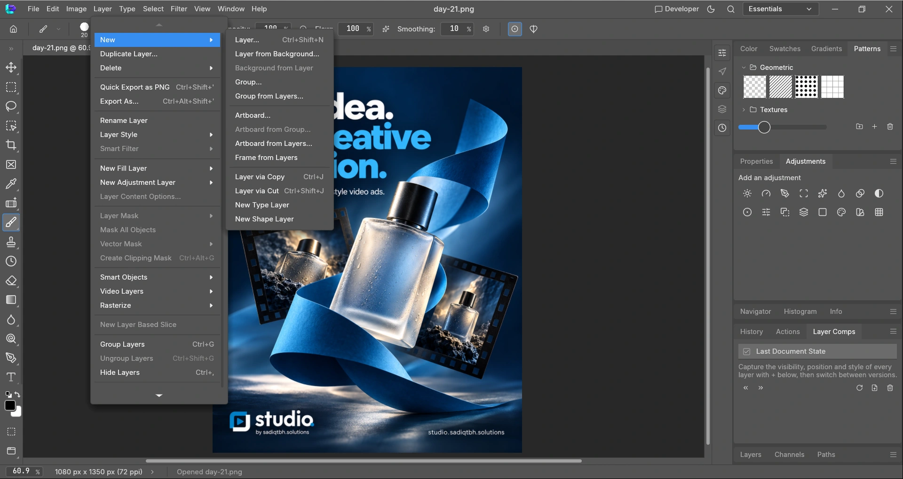
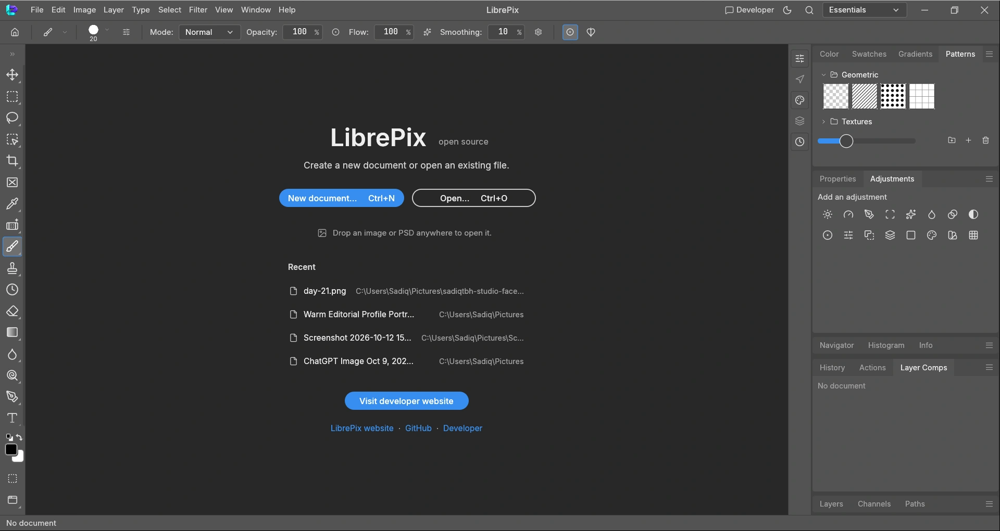

<div align="center">


# LibrePix

### Your vision. Freely made.
**A modern, versatile, 100% offline image editor for Windows featuring professional layer management, precision adjustments, and native PSD compatibility.**

[-0078D6?style=for-the-badge&logo=windows&logoColor=white)](https://www.librepix.sadiqtbh.app/)
[](https://github.com/sadiqtbh/Librepix/releases)
[](LICENSE)
[](https://www.librepix.sadiqtbh.app/)
[](https://www.librepdf.sadiqtbh.app/)

<br/>

### 🌐 Direct Download Portal: [**librepix.sadiqtbh.app**](https://www.librepix.sadiqtbh.app/)

[**Download Windows Installer (.msi)**](https://github.com/sadiqtbh/Librepix/releases/download/v0.9.0/LibrePix-0.9.0-by_Yeasin_Arafat_Sadiq.msi) &nbsp;•&nbsp; [**Media & Screenshot Kit (.zip)**](https://github.com/sadiqtbh/Librepix/releases/download/v0.9.0/LibrePix-Screenshots.zip) &nbsp;•&nbsp; [**Official Web Portal**](https://www.librepix.sadiqtbh.app/) &nbsp;•&nbsp; [**Try LibrePDF Document Workspace**](https://www.librepdf.sadiqtbh.app/)

</div>

---

## 🌟 Overview

Whether you are retouching photos, designing digital marketing visuals, or drafting graphics with intricate layer hierarchies, **LibrePix** delivers a complete desktop creative studio. Built natively for Windows, it features a fluid canvas, non-destructive layer stacks, high-precision adjustment curves, and seamless Adobe Photoshop (`.psd`) file import and export.

**LibrePix** operates entirely on your local machine with zero subscription barriers, zero forced cloud accounts, and zero watermarks. Your artwork remains private, secure, and under your total control.

---

## 📸 Application Visual Showcase ([Official Web Walkthrough](https://www.librepix.sadiqtbh.app/))

<div align="center">

### 1. Unified Creative Studio Workspace
*High-performance editing canvas with interactive tool palette, layer hierarchy inspector, floating adjustment controllers, and zoom navigator.*


<br/><br/>

### 2. Precision Color & Tone Adjustments
*Comprehensive non-destructive image adjustments including Curves, Levels, Exposure, Vibrance, Hue & Saturation, Color Balance, and Invert filters.*


<br/><br/>

### 3. Professional Layer Architecture & Blend Modes
*Flexible layer management supporting raster layers, vector shapes, typographic text blocks, layer grouping, masks, opacity tuning, and industry-standard blending modes.*


<br/><br/>

### 4. Streamlined Home & Project Hub
*Clean onboarding hub to create new custom canvas templates, open recent graphic projects, or import external files directly into the editor.*


</div>

---

## ✨ Key Superpowers

- 🎨 **Multi-Layer Composition**: Organize graphics with raster layers, shape layers, text layers, layer groups, and customizable blend modes.
- 📈 **Precision Adjustment Engine**: Fine-tune imagery with Curves, Levels, Exposure, Vibrance, Hue/Saturation, and Color Balance tools.
- 📁 **Native PSD File Compatibility**: Open, edit, and save multi-layered Adobe Photoshop (`.psd`) documents with preserved layers and blend modes.
- 📐 **Vector & Typography Tools**: Draw precision shapes, paths, and vector elements; format crisp typography with extensive font controls.
- 🔒 **100% Offline & Private**: Zero network dependencies, zero telemetry, and zero forced cloud uploads. All rendering happens directly in local hardware memory.
- 🆓 **Free & Open Source Forever**: Licensed under the permissive MIT License with zero recurring fees or locked features.

---

## 📦 Downloads & Packages

| Package File | Platform | Architecture | Size | Description | Link |
| :--- | :--- | :---: | :---: | :--- | :--- |
| **`LibrePix-0.9.0-by_Yeasin_Arafat_Sadiq.msi`** | Windows 10 / 11 | x64 | ~125.5 MB | **Official Windows Installer** with setup wizard and start menu integration | [Download](https://github.com/sadiqtbh/Librepix/releases/download/v0.9.0/LibrePix-0.9.0-by_Yeasin_Arafat_Sadiq.msi) |
| **`LibrePix-Screenshots.zip`** | All Platforms | Independent | ~1.4 MB | High-Resolution Press & Media Screenshot Showcase bundle | [Download](https://github.com/sadiqtbh/Librepix/releases/download/v0.9.0/LibrePix-Screenshots.zip) |
| **Official Web Mirror** | Web Portal | Browser | — | Direct web portal and download mirror | [librepix.sadiqtbh.app](https://www.librepix.sadiqtbh.app/) |

### Cryptographic Checksum (SHA-256)
```text
File:   LibrePix-0.9.0-by_Yeasin_Arafat_Sadiq.msi
SHA256: CF73E0F89D263DD33484A26F9980290E294D6C0E02D6A0B5878CADD42A5BF91F
```

---

## ⚡ What's in Version 0.9.0

- **Integrated Studio Canvas**: Fluid pan, high-magnification zoom, and hardware-accelerated preview rendering.
- **Tone & Color Adjustments**: Complete panel for Curves, Levels, Color Balance, Vibrance, and Exposure adjustments.
- **Advanced Layer Management**: Full support for layer hierarchies, grouping, opacity adjustment, and blend mode switching.
- **PSD Workflow Integration**: Import and export standard multi-layered PSD files seamlessly.
- **Clean Windows Installer**: Certified setup package with start menu shortcuts and clean uninstaller support.

---

## 📄 Companion Application

Check out **[LibrePDF](https://github.com/sadiqtbh/Librepdf)** ([librepdf.sadiqtbh.app](https://www.librepdf.sadiqtbh.app/)) — the lightweight, 100% offline document workspace for reading, organizing, filling, and exporting PDFs on Windows.

---

## 👨‍💻 Developer & Attribution

Developed with passion by **Yeasin Arafat Sadiq**  
🌐 **Official Website**: [https://www.librepix.sadiqtbh.app/](https://www.librepix.sadiqtbh.app/)  
👨‍💻 **Developer Portfolio**: [https://www.sadiqtbh.dev](https://www.sadiqtbh.dev)  
🐙 **GitHub Profile**: [@sadiqtbh](https://github.com/sadiqtbh)  
📄 **Companion Project**: [LibrePDF](https://github.com/sadiqtbh/Librepdf)
